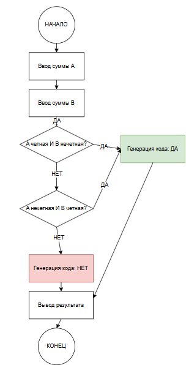

# Домашнее задание к работе 4

## Условие задачи
**Банк отправляет клиенту секретный код для подтверждения операции. Код будет сгенерирован, если только одна из сумм (A или B) в последних двух операциях была четной.**

---

## 1. Алгоритм и блок-схема

### Алгоритм

1. **Начало**
2. **Ввод данных:**
   - Считать сумму первой операции (A)
   - Считать сумму второй операции (B)
3. **Проверка условия:**
   - Проверить: A четная И B нечетная
   - Если ДА → перейти к шагу 5
   - Если НЕТ → перейти к шагу 4
4. **Дополнительная проверка:**
   - Проверить: A нечетная И B четная
   - Если ДА → перейти к шагу 5
   - Если НЕТ → перейти к шагу 6
5. **Генерация кода:**
   - Сгенерировать секретный код
   - Отправить код клиенту
   - Вывести сообщение об успехе
6. **Отказ в генерации:**
   - Вывести сообщение об отказе
7. **Конец **

### Блок-схема
 
## 2. Реализация программы
```c
void TaskDZ() {
    int A, B;

    printf("Введите сумму первой операции (A): ");
    scanf("%d", &A);
    printf("Введите сумму второй операции (B): ");
    scanf("%d", &B);
    if ((A % 2 == 0 && B % 2 != 0) || (A % 2 != 0 && B % 2 == 0)) {
        printf("Условие выполнено! Секретный код сгенерирован и отправлен.\n");
    }
    else {
        printf("Условие не выполнено. Код не сгенерирован.\n");
    }

    return 0;
}
```
## 3. Результаты работы программы
Введите сумму первой операции (A): 12
Введите сумму второй операции (B): 43
Условие выполнено! Секретный код сгенерирован и отправлен.

## 4. Информация о разработчике

Тухватулин Евгений Романович, бТИИ-261
